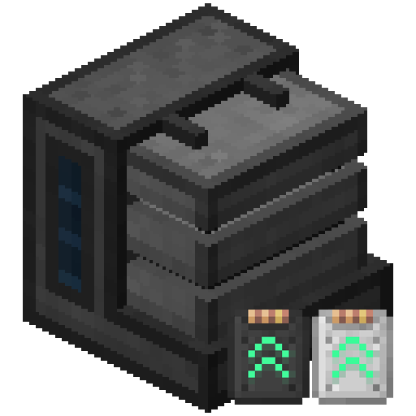

<p align="center"></p>

<h1 align="center">MekaJade Upgrades Fixed</h1>

<p align="center">用 Jade 看向通用机械的机器时，在提示框里显示这台机器已装上的升级图标和数量。<br>
<strong>MekaJadeUpgrades</strong>（作者 DevDyna）的非官方修复分支，与原版作者无关、也未获其背书。</p>

<p align="center">中文 | <a href="./README_EN.md">English</a></p>

<p align="center">
  <a href="https://github.com/zaixiayesheng/MekaJadeUpgradesFixed/releases"></a>
  
  
  
  
  
  <a href="https://github.com/zaixiayesheng/MekaJadeUpgradesFixed/issues"></a>
</p>

<p align="center"><a href="#-这是什么">📖 这是什么</a> · <a href="#-与原版的区别">🔧 与原版的区别</a> · <a href="#-安装">📦 安装</a> · <a href="#-配置">⚙️ 配置</a> · <a href="#-构建">🛠️ 构建</a> · <a href="#-更新日志">📜 更新日志</a> · <a href="#-许可证与署名">⚖️ 许可证与署名</a> · <a href="#-反馈">🐛 反馈</a></p>

## 📖 这是什么

用 Jade 看向通用机械的机器时，在提示框里显示这台机器已装上的升级图标和数量。本分支是 **MekaJadeUpgrades**（作者 DevDyna）的修复分支，**非官方**，与原版作者无关、也未获其背书。

本 README 对应 **1.20.1 / Forge 47** 分支；1.21.1 / NeoForge 的实现见仓库的 `1.21.1` 分支。

| | |
|---|---|
| 原版模组 | **MekaJadeUpgrades (Mekanism addon)**，作者 **DevDyna** |
| 原版 CurseForge | https://www.curseforge.com/minecraft/mc-mods/mekajadeupgrades |
| 原版 GitHub | https://github.com/DevDyna/MekaJadeUpgrades |
| 原版协议 | **MIT License，Copyright (c) 2024-2030 DevDyna** |
| 本分支协议 | MIT；原作者的版权声明保留在 [LICENSE](./LICENSE) 里，并附上分支作者的版权行 |
| 本分支源码 | https://github.com/zaixiayesheng/MekaJadeUpgradesFixed |
| 本分支平台 | **Minecraft 1.20.1 / Forge 47.4**（JDK 17，Java 17 字节码） |

## 🔧 与原版的区别

改动的只有下面这几处，图标、升级支持、工程结构等其余部分都来自原版：

- **提示框溢出**：原版给每个图标加固定横向偏移来定位，但 Jade 的行宽只按元素自身尺寸计算、偏移不计入宽度，于是绘制位置跑到面板外面——升级种类一多（装了通用机械扩展、增强解放之后）就出框。现在改成**按宽度自动换行**、横向不再加偏移，任何分辨率、任何 GUI 缩放下都不会溢出。
- **图标与数字对齐**：保留竖直方向的 1~2 像素微调，图标和数量文字在同一水平线上。
- **版本适配**：直接识别合并版 **Mekanism: Empowered Unleashed**（新 id `mekanism_empowered_unleashed`），旧 id `mekanism_empowered` 也一并保留。1.20.1 这一支还跟着 Mekanism 10.4 与 Jade 11 的 API 做了适配：升级名读 `Upgrade#getRawName()`、气体升级是 `Upgrade.GAS`、`IElement.Align` 用 `values()`、扩展模组的包名是 `com.jerry.mekanism_extras`。
- **同时装了原版时自动停用原版**：配置项 `disableMekaJadeUpgrades`（默认开启），避免升级那一行显示两遍。
- **只保留 Jade 提示框部分**：本分支只包含原版里负责 Jade 提示框的代码，其余原版代码未包含。

## 📦 安装

| 文件 | 说明 |
|---|---|
| `mekajadeupgrades_fixed-1.20.1-*.jar` | 本模组 |
| Jade（1.20.1 版，11.x） | 必需 |
| Mekanism 1.20.1（10.4.16 及以上） | 必需 |
| 通用机械：扩展（`mekanism_extras` 1.5.0 及以上） | 可选，装了就会显示它的升级图标 |
| Mekanism: Empowered Unleashed（20.1-1.0.0 及以上） | 可选，装了就会显示强化升级图标 |

- 平台：Minecraft 1.20.1 / Forge 47.4（47.x）
- 一般不需要再装原版 MekaJadeUpgrades：两个模组都会在提示框里加同一行升级。万一两个都装了，本模组会自动停用原版（用 mixin 掐掉它的提示框和数据入口，只取消、不改别的，不会崩），由本模组接管显示，并在日志里说明。该行为由配置 `disableMekaJadeUpgrades` 控制，默认开启。

## ⚙️ 配置

配置文件：`config/mekajadeupgrades_fixed-common.toml`

| 配置项 | 默认 | 说明 |
|---|---|---|
| `disableMekaJadeUpgrades` | true | 与原版 MekaJadeUpgrades 同时安装时停用原版，由本模组接管；关掉则两者都生效（会显示两行升级） |

## 🛠️ 构建

环境：JDK 17。

1. 把编译用的 jar 放进项目根目录的 `libs/`（这些是本模组的编译依赖，不随仓库分发）：
   - Jade（`jade-1.20.1-forge-*.jar`）
   - Mekanism（`mekanism-10.4.*.jar`，1.20.1 的 Mekanism 文件名里没有游戏版本号）
   - Mekanism Generators（`mekanism-generators-10.4.*.jar`）
   - 通用机械：扩展（`mekanism_extras-1.20.1-*.jar`）
   - Kotlin for Forge（`kotlinforforge-4.12.0-all.jar`，增强·解放的硬依赖）
   - 通用机械：增强·解放（`MekanismEmpoweredUnleashed-1.20.1-*.jar`）

   文件名与 maven 坐标的对应关系写在 `settings.gradle` 的 `localDeps` 表里，换版本时改那张表。
2. 执行：

```
gradlew build
```

`settings.gradle` 会先把 `libs/` 复制成 `libs-maven/`（本地 maven 仓库）：1.20.1 的正式版 jar 是 SRG 名，而 dev 与运行时是 Mojmap 名，只有写成模块坐标 `modImplementation '组:名:版本'`，ModDevGradle 才会替我们重映射；直接 `implementation fileTree('libs')` 会在运行时抛 `NoSuchMethodError`。

产物在 `build/libs/`。想跑服务端冒烟测试：`gradlew runServer`。

## 📜 更新日志

### 1.20.1-1.0.0

- 首次发布 1.20.1 / Forge 47 版本：把 1.21.1 分支的全部功能与修复移植过来
- 提示框按宽度自动换行，升级图标不再溢出面板
- 图标与数量文字对齐
- 识别 Mekanism: Empowered Unleashed（`mekanism_empowered_unleashed`）与旧 id `mekanism_empowered`
- 同时安装原版 MekaJadeUpgrades 时自动停用原版（配置 `disableMekaJadeUpgrades`）
- 两处 mixin 加 `require = 0`：原版以后改了方法名或签名时只是不生效，不会让游戏启动崩溃
- 认不出的升级、或附属模组的类对不上时，退回占位图标并在日志里提示一次
- Jade 配置界面的插件名支持中文

## ⚖️ 许可证与署名

- 原版 [MekaJadeUpgrades](https://github.com/DevDyna/MekaJadeUpgrades)：MIT License，Copyright (c) 2024-2030 DevDyna
- 本分支：MIT License，Copyright (c) 2026 zaixiayesheng
- 完整协议文本见 [LICENSE](./LICENSE)，其中同时保留了原作者的版权声明
- 除上面「与原版的区别」里列出的改动之外，其余代码、图标与资源均来自原版

## 🐛 反馈

- 本分支的问题请提到 [GitHub Issues](https://github.com/zaixiayesheng/MekaJadeUpgradesFixed/issues)，附上 Minecraft、Forge、Jade 与 Mekanism 的版本
- 原版模组本身的问题请找原作者 DevDyna
